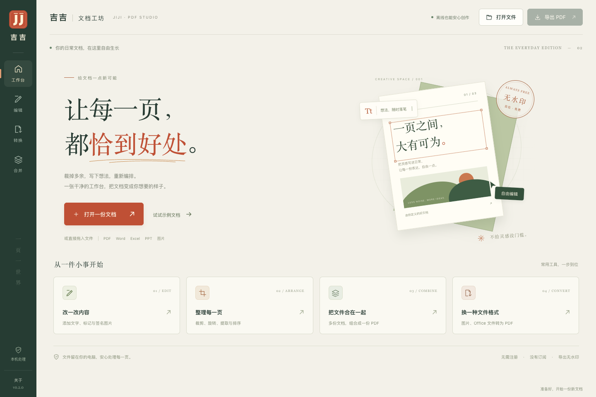
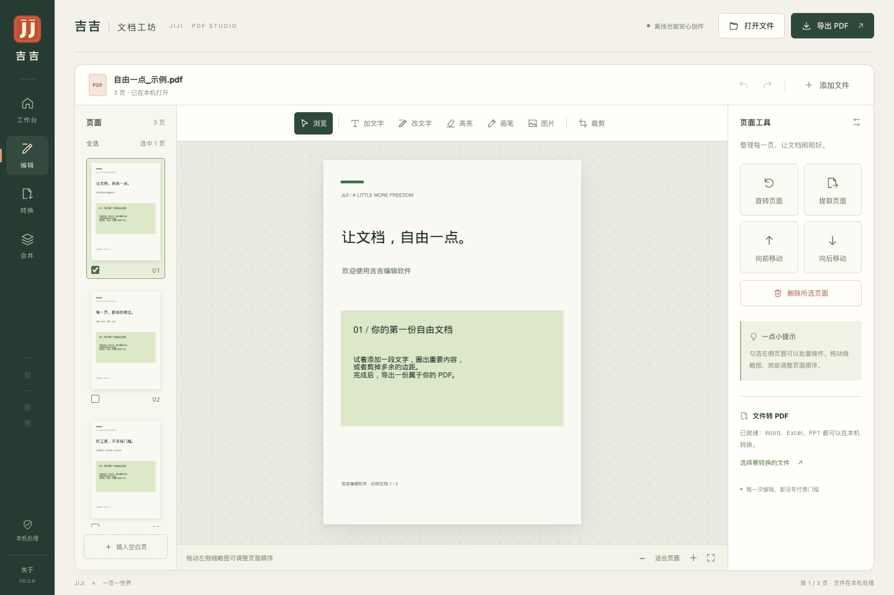

# 吉吉编辑软件 · Jiji Editor

免费、本地运行的中文 PDF 工作台。没有会员、没有导出水印，不会把文档上传到云端。

[下载 Windows / Mac 版本](https://github.com/2017Rocke/jiji-editor/releases/latest) · [安装说明](docs/INSTALL.md) · [开发与构建](docs/DEVELOPMENT.md) · [开源项目调研](docs/research/调研与选型.md)



v0.2.0 采用暖纸色、墨绿和朱红的文档工坊界面。首页提供编辑、裁剪、合并与转换快捷入口；打开文档后切换到专注编辑布局。返回工作台时保留当前会话，可以继续编辑；退出前仍需导出保存。



## 下载哪个版本

| 电脑 | 下载文件名中的标记 | 使用方法 |
| --- | --- | --- |
| Windows 10 / 11，64 位 Intel / AMD | `Windows-x64.zip` | 解压整个文件夹，双击 `JijiEditor.exe`；编辑器在默认浏览器中打开 |
| Mac，M1 / M2 / M3 / M4 等 Apple Silicon | `macOS-arm64.zip` | 解压，将“吉吉编辑软件.app”拖入“应用程序” |
| Mac，Intel 芯片 | `macOS-x86_64.zip` | 解压，将“吉吉编辑软件.app”拖入“应用程序” |

下载包包含 Python 和 PDF 引擎，**使用者无需安装 Python**。Mac 目标系统为 macOS 13 或更新；旧系统兼容性仍需实机验证。Windows 包为免安装版，保留随包 `_internal` 文件夹；目前不提供 Windows ARM64 原生包。

下载包没有商业代码签名，Mac 尚未公证，操作系统可能提示验证开发者。源码、构建流程和 SHA-256 校验值均公开。正式下载入口是本仓库的 Releases。

## 能做什么

- **转换 PDF**：图片、TXT；Word、Excel、PowerPoint 与 ODT/ODS/ODP 等 Office 格式。
- **整理页面**：裁剪、旋转、删除、拖动排序、插入空白页、合并文件、提取所选页。
- **编辑内容**：中英文文字添加、已有横排文字局部替换、区域高亮、画笔、图片和签名图片。
- **保存与恢复**：撤销 / 重做、失败回滚、另存为无水印 PDF；不自动覆盖原文件。

**Office 转 PDF 需要独立安装免费的 [LibreOffice](https://www.libreoffice.org/)**；PDF 编辑、图片和文本转换不需要 LibreOffice。转换质量受原文档字体和特殊版式影响，重要文件请检查输出。不同电脑之间，通过原始文档和导出的 PDF 交换文件；本软件没有云同步。

## 最快上手

1. 打开软件，选择文件或拖入文件；也可以先点“示例文档”。
2. 左侧切页或勾选多个页面，右侧进行页面操作。
3. 添加文字时，先在页面上框选区域，再点“应用”。裁剪时，勾选左侧需要处理的页面，在预览页框选保留区域（或选择四周裁去 5% / 10%），点击“裁剪选中的 N 页”。不同尺寸和旋转页面按各自显示尺寸的相同比例裁剪，未勾选页不变；一次撤销可恢复整批页面。裁剪模式点击缩略图只切换预览，勾选状态保留。修改原文字时，先点页面中已有的横排文字。
4. 完成后点右上角“导出 PDF”。Windows 浏览器版请确认文件已出现在下载目录。
5. 退出前先导出；Windows 关闭浏览器页面后，还需从吉吉启动窗口退出本机服务。

## 从源码运行

需要 Python 3.10 或更新版本；建议使用 Python 3.12。首次安装依赖需要联网，安装后可以离线使用。

```sh
git clone https://github.com/2017Rocke/jiji-editor.git
cd jiji-editor
python3 -m venv .venv
.venv/bin/python -m pip install -r requirements.txt
.venv/bin/python server.py
```

Windows 在项目目录执行：

```powershell
py -3.12 -m venv .venv
.venv\Scripts\python -m pip install -r requirements.txt
.venv\Scripts\python windows_launcher.py
```

服务只监听 `127.0.0.1`，自动选择端口，使用随机会话令牌并校验请求来源。没有账号、遥测或外部 PDF API。可通过 `JIJI_SOFFICE` 指定 LibreOffice 可执行文件路径。

## 当前边界

- 这是 PDF 工具，暂不包含完整 Word / Excel / PPT 编辑器。
- 原文字修改为局部替换：删除选中行的文字对象，再绘制新内容。字体可能变化；不支持任意段落重排、扫描件 OCR、竖排和斜排文字编辑。
- 裁剪只改变可见页面边界，不是安全涂黑或脱敏工具。签名图片不是数字签名。
- 合并按页面处理，复杂表单脚本、文档目录、附件和数字签名不保证保留。
- 单文件最大 64 MB，单次合计 128 MB、最多 40 个文件，合并后最多 1000 页。撤销最多 20 次，并受快照内存预算限制。
- 编辑保存在当前会话，尚无自动保存或崩溃恢复。退出前请导出。

## 构建与验证

GitHub Actions 在 Windows x64、Mac arm64 和 Mac Intel 上分别执行核心测试、构建应用，并运行**打包后的程序**验证中文编辑、渲染和 PDF 导出。全部成功后，带 `v` 的版本标签才自动生成公开 Release。普通代码提交另运行跨平台测试。实际结果见 [Actions](https://github.com/2017Rocke/jiji-editor/actions)。

本地构建、浏览器测试、Office 样例生成和发布步骤见 [开发说明](docs/DEVELOPMENT.md)。

## 开源许可

本项目采用 **GNU AGPL v3**，见 [LICENSE](LICENSE)。PDF 内核复用 [PyMuPDF / MuPDF](https://github.com/pymupdf/PyMuPDF)，Office 转换使用独立安装的 LibreOffice。界面、编辑流程、本机服务和桌面启动器由本项目实现。

免费使用不收费；再分发、修改或提供网络服务时，请遵守 AGPL 的对应源码要求。应用包附带项目源码和第三方许可。完整说明见 [THIRD_PARTY_NOTICES.md](THIRD_PARTY_NOTICES.md)。
